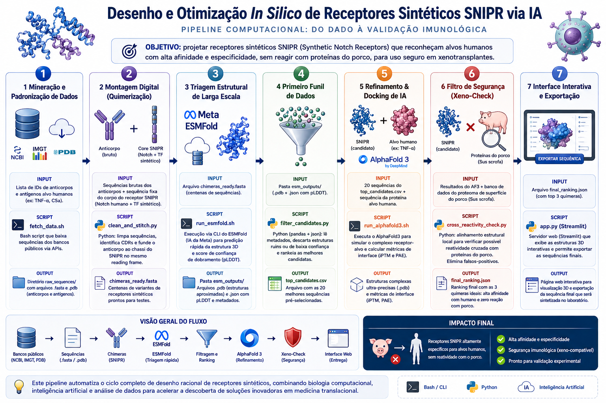

# SNIPR In Silico IA - Protótipos Interativos

Este repositório contém os protótipos interativos desenvolvidos para o projeto de *"Desenho e Otimização In Silico de Receptores Sintéticos SNIPR com foco em Mitigação da Rejeição em Xenotransplantes Suínos"*, servindo como ferramenta de validação conceitual e apresentação de arquitetura de dados.

## Resumo Visual

## Links dos Protótipos

* [Construtor Modular de Receptores (Baseado em CSV/Cores)](snipr_builder.html)
* [Painel com estruturas 3D de Receptor-Ligante](xeno_design.html)
* [Fluxograma Técnico Interativo](fluxograma.html)

## Módulos personalizados no construtor

O construtor funciona no GitHub Pages e ao abrir `snipr_builder.html` diretamente, sem backend. A biblioteca padrão fica em `snipr_modules.js`, carregada antes da lógica da interface.

Em qualquer um dos cinco módulos, abra **Adicionar / editar sequência personalizada**, informe um nome e uma sequência proteica (ou um único registro FASTA) e clique em **Aplicar sequência**. Espaços são removidos, letras são convertidas para maiúsculas e o comprimento é calculado a partir da sequência. A entrada personalizada pode ser editada e reaplicada; os módulos originais continuam disponíveis no seletor.

A montagem, a visualização e os arquivos FASTA/GenPept usam os módulos selecionados. Montagens com módulos personalizados mostram score **N/D**, pois essas sequências não possuem score atribuído.

O FASTA (`.fasta`) contém a sequência proteica completa. O GenPept (`.gp`) contém a mesma sequência, com um registro `Protein` e anotações `Region` para o peptídeo sinal, tag myc, scFv e demais módulos. As coordenadas são de aminoácidos, começando em 1, na proteína completa antes de processamento. O peptídeo sinal e a tag só são anotados quando os prefixos exatos da biblioteca estão presentes no LBD; nenhuma sequência é acrescentada aos módulos personalizados. O identificador `SNIPR` é local, sem accession atribuído pelo NCBI.

Para ler o `.gp` com Biopython, use `Bio.SeqIO.read(arquivo, "genbank")`: o leitor também reconhece registros proteicos GenPept pelo comprimento em `aa`.

Os testes de exportação usam Node.js e Python com Biopython instalado. Execute `python -m unittest discover -s tests -v` para conferir a leitura dos arquivos, sequências, coordenadas e referências nas 128 combinações da biblioteca e em sequências personalizadas.

Entradas personalizadas e seleções ficam no armazenamento local do navegador, sem envio a um servidor. Não são compartilhadas entre dispositivos e podem ser perdidas ao limpar os dados do navegador; exporte a montagem para conservar sua sequência. Se o armazenamento estiver indisponível, a interface informa que a entrada vale apenas para a sessão atual.
